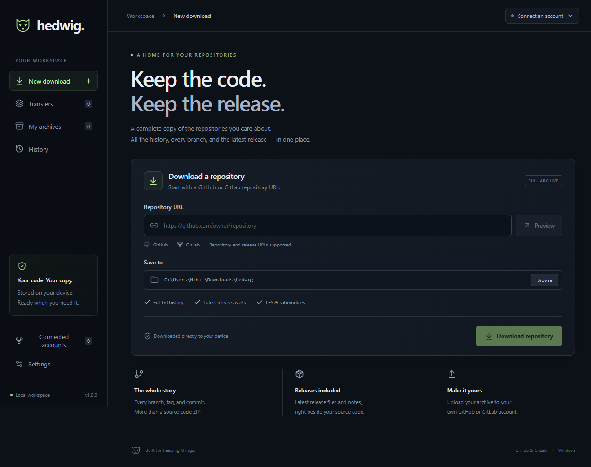
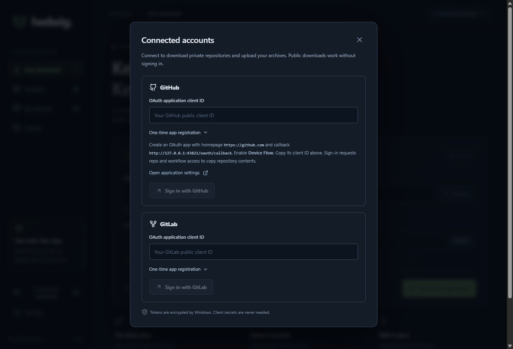
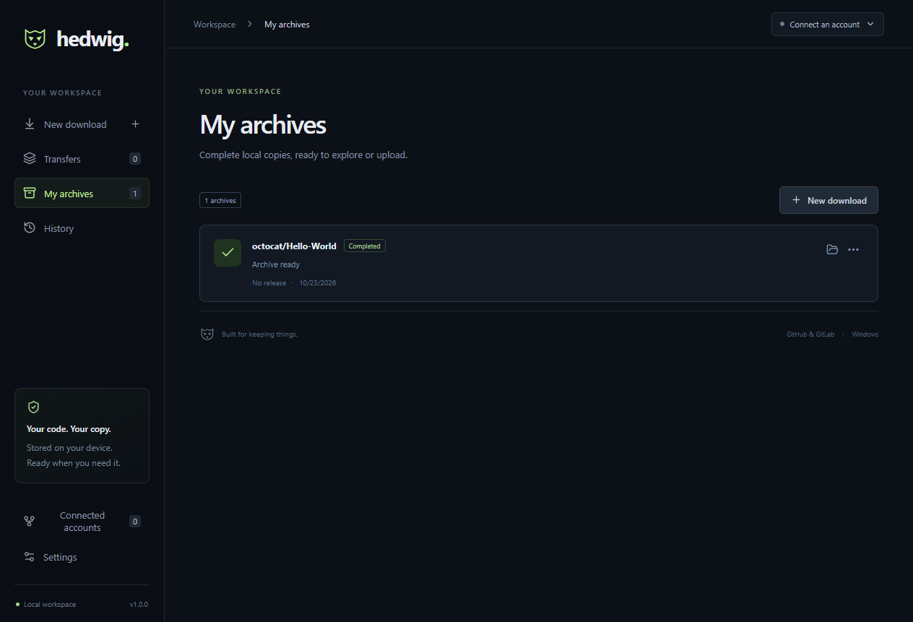
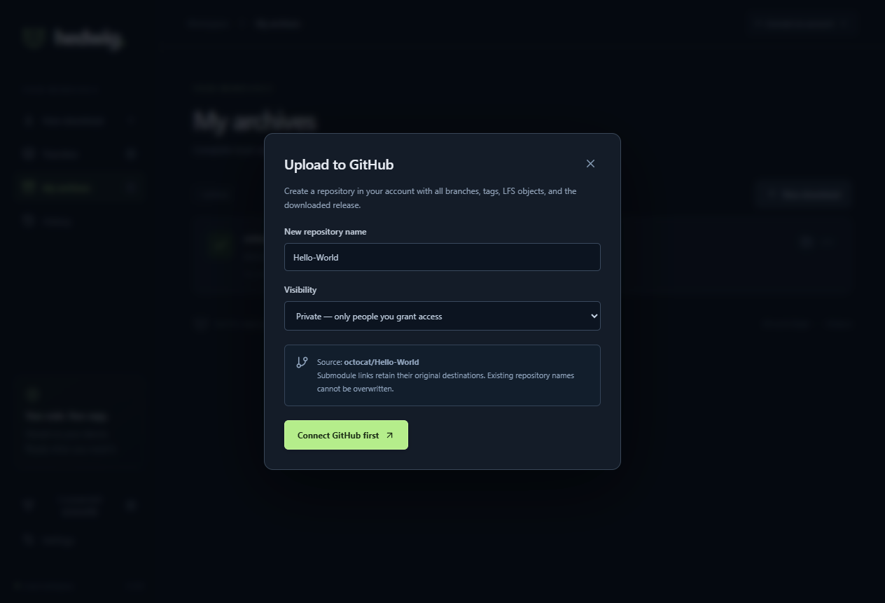
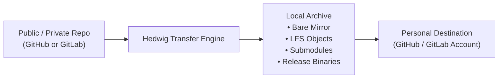

<div align="center">


# Hedwig

**Keep the code. Keep the release.**

_A secure Windows desktop application for archiving full Git repositories, historical submodules, and release binaries — with direct transfer to personal GitHub or GitLab accounts._

<p>
  <a href="LICENSE"></a>
  
  
  
  
  
</p>

---

<p>
  <a href="#-about-hedwig">About</a> •
  <a href="#-key-features">Features</a> •
  <a href="#-visual-tour">Visual Tour</a> •
  <a href="#-how-it-works">How It Works</a> •
  <a href="#-archive-layout">Archive Layout</a> •
  <a href="#-browser-sign-in-setup">OAuth Setup</a> •
  <a href="#-installation--usage">Installation</a> •
  <a href="#-building-from-source">Building</a> •
  <a href="#-architecture--security">Architecture</a> •
  <a href="#-icon--design-philosophy">Design</a> •
  <a href="#-license">License</a>
</p>

<picture>
  
</picture>

</div>

---

## 🦉 About Hedwig

Named after the faithful courier owl that reliably delivers critical parcels across boundaries, **Hedwig** is a Windows desktop application engineered for developers who demand complete, high-fidelity custody of their source code and releases.

Standard repository cloning or ZIP downloads often leave critical assets behind: release installer binaries, Git Large File Storage (LFS) payloads, historical submodule trees, and release release notes. **Hedwig solves this by creating comprehensive, offline-first local archives and enabling seamless cross-provider transfers to your personal GitHub or GitLab account.**

- 🪟 **Self-Contained Windows Application**: Packaged with its own embedded Git for Windows and Git LFS distributions—no external toolchain required on target machines.
- 📦 **Total Fidelity Preservation**: Bare Git mirrors capture all branches and tags, Git LFS downloads full binary objects, and dedicated checkouts provide immediately browsable source files.
- 🧩 **Deep Submodule Resolution**: Recursively archives historical submodule commits across gitlinks and merge parents rather than merely grabbing current HEAD links.
- 🛡️ **Zero-Credential Renderer Security**: Tokens are encrypted at rest with Windows DPAPI via Electron `safeStorage`. Git operations run through host-scoped credential helpers—tokens are never stored in plain text or written to `.git/config` remotes.
- 🔄 **Autonomous Destination Upload**: Recreates repositories in your personal namespace (defaulting to private), pushes mirror histories, uploads LFS objects, and republishes releases with attached binary files.

---

## ✨ Key Features

<table>
  <tr>
    <td width="50%">
      <h3>🔍 Repository &amp; Release Preview</h3>
      <p>Paste any public or authenticated HTTPS repository or release-page URL from GitHub or GitLab (including nested GitLab groups) to inspect branches, tags, and assets before downloading.</p>
    </td>
    <td width="50%">
      <h3>🌿 Complete Mirroring &amp; Git LFS</h3>
      <p>Clones bare Git mirrors containing all branches, tags, and commit trees. Automatically resolves and downloads all tracked Git LFS objects and prepares an independent default-branch checkout.</p>
    </td>
  </tr>
  <tr>
    <td width="50%">
      <h3>🧩 Recursive Submodule Archiving</h3>
      <p>Inspects gitlinks across the entire commit graph to archive nested and historical submodule commits into isolated bare mirrors with structured index manifests.</p>
    </td>
    <td width="50%">
      <h3>🚀 Direct GitHub &amp; GitLab Transfers</h3>
      <p>One-click upload to your connected personal GitHub or GitLab account. Automatically pushes code, tags, LFS assets, and re-attaches releases to GitHub releases or GitLab Package Registries.</p>
    </td>
  </tr>
  <tr>
    <td width="50%">
      <h3>🔒 Windows DPAPI Credential Security</h3>
      <p>OAuth tokens and refresh tokens are encrypted at rest using Windows DPAPI / Electron <code>safeStorage</code>. Browser sign-in uses OAuth Device Flow (GitHub) and PKCE (GitLab).</p>
    </td>
    <td width="50%">
      <h3>⚡ Resilient Queue &amp; Validated Resume</h3>
      <p>Serial background transfer engine with stage checkpoints, HTTP range resume, SHA-256 verification receipts, cancellation, and durable recovery across unexpected system restarts.</p>
    </td>
  </tr>
</table>

---

## 📸 Visual Tour

### 1. Intuitive Repository Inspection &amp; Download Setup

Paste any GitHub or GitLab repository URL, choose your destination folder, and inspect branches, tags, and release metadata in real time before initiating transfers.

<p align="center">
  
</p>

### 2. Connected Accounts &amp; Secure Browser Sign-in

Manage GitHub and GitLab authentication safely with one-time application registrations. Tokens are encrypted using Windows DPAPI and never exposed to the UI renderer process.

<p align="center">
  
</p>

### 3. Archive Management &amp; Transfer Integrity

Review completed local archives under **My archives**, check transfer stages, inspect local file sizes, and access archive options for one-click upload or local browsing.

<p align="center">
  
</p>

### 4. Cross-Provider Upload to Personal Namespace

Transfer any completed archive directly to your GitHub or GitLab profile. Defaulting to private visibility, Hedwig re-creates the remote repository, pushes full history, and attaches release assets.

<p align="center">
  
</p>

---

## 📋 How It Works



1. **Input URL**: Paste an HTTPS repository or release-page URL from `github.com` or `gitlab.com` (nested GitLab group hierarchies supported).
2. **Preview**: Verify repository health, default branch, tag counts, and release asset listings. Select a target storage folder.
3. **Download &amp; Verify**: Hedwig clones a bare mirror, resolves Git LFS pointers, archives required historical submodule commits, downloads release binaries with SHA-256 validation receipts, and prepares a ready-to-browse default branch checkout.
4. **Upload**: Select an archive in **My archives**, pick your connected GitHub or GitLab account, specify a repository name and visibility (default: private), and Hedwig synchronizes history, LFS, and releases.

---

## 📁 Archive Layout

Each downloaded archive is stored in a clean, self-contained directory containing complete metadata and verification manifests:

```text
repository-name-<job-id>/
├── manifest.json            # Archive metadata, stage checkpoints, asset SHA-256 receipts
├── repository.git/          # Bare Git mirror: all branches, tags, commit graph, LFS objects
├── source/                  # Independent default-branch working tree with full LFS content
├── submodules/
│   ├── index.json           # Source URLs, local relative paths, required commits
│   └── <url-hash>/          # Bare submodule mirror with required historical commits
└── release/
    ├── release.json         # Release metadata (tag name, title, publication timestamp)
    ├── RELEASE_NOTES.md     # Full markdown release body and changelog
    └── assets/              # Downloaded release binary files, installers, checksums
```

### Archive Integrity Highlights

- **Bare Mirror (`repository.git/`)**: Retains every branch and tag with its full commit graph. Provider-internal refs (such as GitHub PR refs) are excluded to ensure clean upstream mirrors.
- **Immediate Source Checkout (`source/`)**: Provides an uncompressed, browsable working directory of the default branch with Git LFS objects fully materialized.
- **Deep Historical Submodules (`submodules/`)**: Inspects all commits that altered gitlinks or `.gitmodules` (including root commits and merge parents). Historical commits permitted by the remote server are fetched into dedicated mirrors.
- **Release Verification**: Attached release assets are streamed to disk with Windows-safe collision resolution. SHA-256 checksums are validated against provider digests when available, and cryptographic receipts are stored in `manifest.json`.

---

## 🔑 Browser Sign-in Setup

Open **Connected accounts** from the top header to configure GitHub or GitLab integration.

> [!IMPORTANT]
> **Client IDs are public identifiers.** Never paste client secrets or personal access tokens into Hedwig. Sign-in operates via secure browser authorization.

### GitHub Integration (Device Flow)

1. Create a GitHub OAuth application at [github.com/settings/applications/new](https://github.com/settings/applications/new).
2. Set **Homepage URL** to `https://github.com`.
3. Set **Authorization callback URL** to `http://127.0.0.1:43821/oauth/callback`.
4. In the created application's settings, enable **Device Flow**.
5. Copy the **Client ID** into Hedwig and click **Sign in with browser**.
6. Enter the one-time user code shown in Hedwig into the GitHub verification page.

_Hedwig requests `repo` and `workflow` scopes to create destination repositories, push commits, and preserve workflow configurations._

### GitLab Integration (PKCE)

1. Create an application at [gitlab.com/-/user_settings/applications](https://gitlab.com/-/user_settings/applications).
2. **Uncheck Confidential**.
3. Set **Redirect URI** to exactly `http://127.0.0.1:43821/oauth/callback`.
4. Grant the following scopes: `api`, `read_repository`, and `write_repository`.
5. Copy the **Application ID** into Hedwig and click **Sign in with browser**.

_Browser sign-in utilizes Proof Key for Code Exchange (PKCE) and state nonce validation. The local callback listener activates exclusively during the login handshake and immediately closes._

---

## 🚀 Installation &amp; Usage

### Running the Windows Installer

Hedwig is distributed as an NSIS installer for 64-bit Windows:

```powershell
release/Hedwig-Setup-1.0.0-x64.exe
```

When installed, Hedwig configures:

- Start Menu and Desktop shortcuts featuring the Hedwig shield icon.
- Isolated user configuration and credential storage in `%APPDATA%\Hedwig`.
- **Embedded Git &amp; Git LFS**: Complete, isolated Git binaries bundled directly within the app installation directory. No manual Git setup or PATH modification is needed.

### General Usage Guidelines

- **Public Repositories**: No accounts required. Simply paste an HTTPS URL and click Preview.
- **Account Concurrency**: One active account per provider (GitHub / GitLab) may be connected at a time.
- **Serial Transfer Queue**: Downloads and uploads are queued sequentially to guarantee network stability and prevent disk contention.
- **Interruption Recovery**: If Hedwig is closed or interrupted mid-transfer, reopening the app marks jobs as interrupted with a one-click **Retry** button that resumes partial asset downloads.

---

## 🛠️ Building from Source

### Prerequisites

- **Windows 10 / 11 (x64)**
- **Node.js** v22.12 or newer
- **Git for Windows** (with **Git LFS** enabled)

### Build Commands

1. **Clone the repository:**

   ```powershell
   git clone https://github.com/projectGloria/Hedwig.git
   cd Hedwig
   ```

2. **Install dependencies:**

   ```powershell
   npm ci
   ```

3. **Launch in development mode:**

   ```powershell
   npm run dev
   ```

4. **Execute unit and integration tests:**

   ```powershell
   npm test
   ```

5. **Run the Playwright Electron UI smoke test suite:**

   ```powershell
   npm run test:ui
   ```

6. **Compile and package the Windows installer:**
   ```powershell
   npm run dist
   ```
   _The generated NSIS setup executable will be located in the `release/` directory._

---

## 🔒 Architecture &amp; Security

Hedwig is architected with strict privilege boundaries to protect user credentials and local system files:

```text
┌────────────────────────────────────────────────────────┐
│                   Renderer Process                     │
│        React 19 • Lucide Icons • Tailwind CSS          │
│   (Sandboxed: Zero FileSystem, Network, or Git access) │
└───────────────────────────┬────────────────────────────┘
                            │ Typed IPC Bridge (preload.cjs)
┌───────────────────────────▼────────────────────────────┐
│                    Electron Main                       │
│    • Windows DPAPI Token Storage (safeStorage)         │
│    • Streaming HTTP Engine (Range Resume & SHA-256)   │
│    • Isolated Git Process Runner                       │
│    • Persistent SQLite / JSON Queue Storage            │
└────────────────────────────────────────────────────────┘
```

- **Credential Isolation**: Tokens and refresh tokens are encrypted at rest using Windows DPAPI / Electron `safeStorage`. Git operations consume credentials through an isolated, host-scoped credential helper without storing tokens in `.git/config`.
- **Safe Process Execution**: Child Git processes disable user and system configurations (`GIT_CONFIG_NOSYSTEM=1`), disallow custom hooks, and are terminated as an atomic process tree upon cancellation.
- **Execution Defense**: Downloaded release files, scripts, and repository contents are **never executed**.
- **Cross-Host Protection**: Redirected download links are stripped of authentication credentials when leaving the originating host domain.

---

## 🎨 Icon &amp; Design Philosophy

<p align="center">
  
</p>

> _"A resilient dark obsidian shield charged with deep forest tones and luminous neon-sage plumage, embodying the watchful gaze and unerring courier flight of Hedwig."_

- **Obsidian Shield Base (`#101821`)**: Denotes uncompromised local security, cryptographic validation, and protected data integrity.
- **Forest Sanctuary (`#17251c`)**: Represents long-term preservation and structured archival storage.
- **Luminous Sage Brow (`#b7ee8b`)**: Evokes precision, rapid delivery across provider boundaries, and clear visual feedback.
- **Clean Silhouette**: Tailored for high-contrast legibility across all Windows taskbar, window titlebar, and high-DPI desktop scaling modes.

---

## 📜 License

Distributed under the **[MIT License](LICENSE)**.

- **Author**: Hedwig Contributors
- **Components**: Bundles Git for Windows and Git LFS under their respective open-source licenses.
- See the full [LICENSE](LICENSE) file for legal details.
